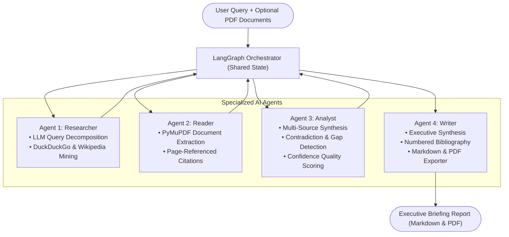

# 🔬 Multi-Agent Research Assistant (₹0 Budget)

An autonomous, production-grade **Multi-Agent Research Assistant** built from scratch with a **₹0 budget**. 

The system accepts any research question or topic, optionally ingests uploaded PDF documents, conducts live automated web research, cross-references findings for contradictions and data gaps, and synthesizes a structured academic research briefing complete with citations and PDF/Markdown export.

---

## 🏗 System Architecture

The project implements a **Blackboard Architecture (Shared State)** orchestrated by **LangGraph**:



---

## 💡 Zero-Budget Technology Stack

| Layer | Technology | Cost | Purpose |
| :--- | :--- | :--- | :--- |
| **Local LLM Inference** | **Ollama (`llama3.2:1b`)** | **₹0.00** | Zero-API-key local inference (~1.3 GB RAM, runs smoothly on CPU). |
| **Agent Orchestration** | **LangGraph & LangChain** | **₹0.00** | Stateful computational graph with conditional quality gates. |
| **Live Web Search** | **DuckDuckGo & Wikipedia** | **₹0.00** | Free web scraping and open REST APIs with zero rate-limit keys. |
| **Document Parsing** | **PyMuPDF (`pymupdf`)** | **₹0.00** | High-performance local PDF text and page chunk extraction. |
| **Frontend UI** | **Streamlit** | **₹0.00** | Reactive web application dashboard with telemetry metrics. |
| **Data Validation** | **Pydantic v2** | **₹0.00** | Strict typed contracts between agents. |
| **Document Export** | **FPDF2 & Markdown** | **₹0.00** | Professional PDF generation and Markdown formatting. |
| **Testing** | **Pytest** | **₹0.00** | Unit and integration test suite. |

---

## 📂 Project Structure

```text
multi-agent-research-assistant/
├── agents/                  # The 4 Specialized Agents
│   ├── researcher.py        # Web search & query decomposition
│   ├── reader.py            # PDF document parser & citations
│   ├── analyst.py           # Cross-referencing & gap analysis
│   └── writer.py            # Academic briefing compilation
├── graph/                   # Orchestration Layer
│   ├── state.py             # Shared TypedDict State schema
│   └── workflow.py          # StateGraph with conditional quality gates
├── tools/                   # Free Tools
│   ├── web_search.py        # DuckDuckGo HTML & Wikipedia search
│   ├── pdf_reader.py        # PyMuPDF chunk extraction with page citations
│   └── report_generator.py  # Markdown and PDF export with fpdf2
├── models/
│   └── schemas.py           # Pydantic data contracts
├── utils/
│   ├── logger.py            # Centralized logging
│   ├── metrics.py           # Persistent execution telemetry tracker
│   └── ollama_manager.py    # Auto-starts and checks Ollama service
├── tests/
│   ├── exercise_1_state.py
│   ├── exercise_2_langgraph.py
│   ├── exercise_3_conditional_edges.py
│   └── test_agents.py       # Pytest unit & integration test suite
├── data/                    # Metrics and local storage
├── reports/generated/       # Generated PDF and Markdown briefings
├── app.py                   # Streamlit Web UI Dashboard
├── main.py                  # CLI Runner
├── requirements.txt         # Dependencies
├── .env.example             # Configuration settings
└── README.md
```

---

## ⚡ Quickstart Guide (Windows)

### 1. Prerequisites
- Python 3.10+ installed
- [Ollama for Windows](https://ollama.com/download) installed
- Pull the 1B local model:
  ```cmd
  ollama pull llama3.2:1b
  ```

### 2. Clone and Setup Environment
```cmd
git clone https://github.com/<your-username>/multi-agent-research-assistant.git
cd multi-agent-research-assistant

# Create and activate virtual environment
python -m venv .venv
.venv\Scripts\activate

# Install dependencies
pip install -r requirements.txt
```

### 3. Run the Test Suite
```cmd
pytest tests/test_agents.py -v
```

### 4. Launch the Streamlit Web Dashboard
```cmd
streamlit run app.py
```
Open your browser at `http://localhost:8501`.

### 5. CLI Execution
```cmd
python main.py --topic "Solid-State Batteries in Aerospace"
```

---

## 💼 Resume & Portfolio Descriptions

### Resume Bullet Points
- **Architected and implemented a Portfolio-Grade Multi-Agent Research Assistant** using LangGraph, Python, and local Ollama (`llama3.2:1b`) achieving ₹0 infrastructure/API cost.
- **Engineered a 4-agent state machine** (Researcher, Reader, Analyst, Writer) using Blackboard Architecture, conditional routing, and quality gates to autonomously mine web indexes, parse local PDFs with PyMuPDF, and produce academic briefings.
- **Built observability telemetry tracking** runtime metrics, source counts, and execution success rates, integrated into an interactive Streamlit UI dashboard.

### Portfolio Overview
> A production-ready, zero-budget Multi-Agent Research Assistant capable of generating comprehensive, citation-backed intelligence briefings in under 90 seconds. Built using LangGraph, Pydantic, and local open-source LLMs running entirely on consumer hardware without external API subscriptions.

